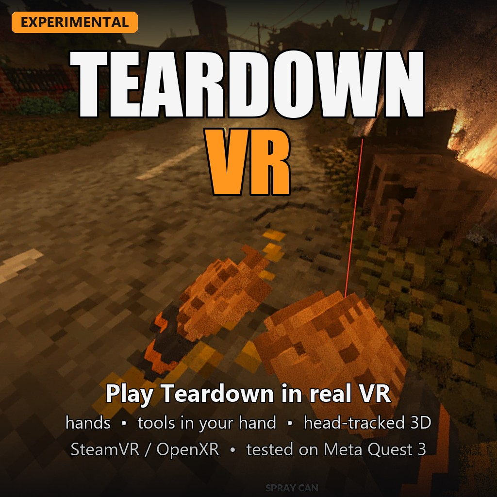

# Teardown VR Mod (experimental)

Play **Teardown** in VR. This mod sends the game to your PC VR headset through **SteamVR (OpenXR)**.
You look around with your head, aim with your hand and pick things up with your own hands.

> **Experimental.** This is an early version made by one hobby modder. Expect bugs.
> **Single-player only.** Do not use it in multiplayer.

## What it does

* **Real 3D with head tracking.** The world is around you and follows your head (look, lean, duck).
* **Hands with gloves.** Both controllers show 3D voxel gloves. Squeeze the grip for a fist, pull the trigger to point.
* **The tool in your hand.** The sledgehammer, guns, spray can and the other tools sit in your right hand and turn with it.
* **Grab and throw with your hands.** Squeeze a grip next to a loose object to pick it up. Let go while you swing to throw it. Moving hands push things.
* **Controller mapping.** Walk, turn, jump, crouch, use tools, open the map and more, all from the controllers.
* **Menus on a screen.** Menus, the map and cutscenes appear on a big flat screen in front of you. Point with the laser and pull the trigger to click.
* **Three VR modes.** Stereo (3D), mono (smoother, no depth) and theater (the whole game on a flat screen).

## Requirements

* Windows 10 or Windows 11
* **Teardown** on Steam (the current version, which uses Direct3D 12)
* **SteamVR**
* A PC VR headset. **Only tested on a Meta Quest 3 through Steam Link.** Other headsets that work with SteamVR may work, but nobody has tried them yet.
* An NVIDIA RTX graphics card is recommended. Teardown is a heavy game and VR needs a high frame rate.

## Download and install

1. Go to the [Releases](../../releases) page and download the latest `.zip` file.
2. Unzip it anywhere (for example on your Desktop).
3. **Close Teardown** if it is running.
4. Double-click **`Install.bat`**. It finds your Teardown folder by itself.
   It copies `dxgi.dll` into the Teardown folder and the Lua mod into `Documents\Teardown\mods\TeardownVR`.
   If it says access is denied, right-click `Install.bat` and choose **Run as administrator**.
5. Start **SteamVR** and connect your headset (Quest 3: start the Steam Link app in the headset).
6. Start **Teardown** from Steam.
7. In the game, open **Mods** > **Local files** > **Teardown VR Mod** and enable it.
8. Load a level. Sandbox mode is a good place to start.

The mod finds SteamVR by itself within a few seconds.

### Game options to change once

These game options shake or blur the VR view, and a mod cannot change them. Set them yourself in Teardown's **Options**:

* Graphics: **Barrel distortion OFF**, **Motion blur OFF**, **Depth of field OFF**
* Graphics: Render scale **100%**
* Input: **Head bob 0**, **Tool sway OFF**

If your Steam shows it: right-click Teardown > *Properties* > *General* and turn off
"Use Desktop Game Theatre while SteamVR is active".

## Steam Workshop version

There is also a **Teardown VR Mod** item on the Steam Workshop. Please read this first:

* The Workshop item contains **only the Lua part** of the mod. It does nothing on its own.
* You **still need `dxgi.dll` from this release**. Run `Install.bat` from the zip as described above.
* **Do not enable both** the Workshop copy and the local copy (Mods > Local files) at the same time. Enable only one of them.
* The Workshop copy and the local copy are the same. Both use the tool models from your own Teardown installation, so it does not matter which one you enable.

## Controls

| Controller | In a level | In menus |
|---|---|---|
| Right trigger | Use tool (left mouse) | Click |
| Right grip | Near an object: pick it up with your hand (let go to throw). Otherwise: the game's normal grab (right mouse) | Right click |
| Left grip | Pick up / throw objects with your left hand | - |
| Left stick | Walk where you look (W A S D) | Arrow keys |
| Right stick left / right | Turn (snap 30 degrees) | - |
| Right stick down / up | Next / previous tool | Scroll |
| A | Jump (press the button fully) | Enter |
| B | Crouch (hold) | Esc |
| X | Interact (E) | - |
| Y | Map (Tab) | - |
| Left menu button | Pause (Esc) | Esc |
| Left menu button, **hold about half a second** | Switch VR mode: stereo > mono > theater > stereo | same |
| Left stick click | Flashlight (F) | - |
| Left stick click, **hold** | Switch aiming: hand or head | same |
| Right stick click | Recenter the view | Recenter the view |

Keyboard (with the game window in focus):

| Key | What it does |
|---|---|
| F6 | Reload the settings file `teardown_vr.ini` |
| F7 | Recenter the view |
| F8 | Switch VR mode |
| F9 | Switch aiming (hand / head) |
| F10 | VR on / off |
| F11 | Show debug values on screen |

### VR modes

* **stereo** (default): real 3D. The eyes take turns, so it needs a high frame rate. Fast movement can look doubled.
* **mono**: both eyes see the same picture, but it still follows your head. Smoother. Try this if stereo makes you feel sick.
* **theater**: the whole game on a big flat screen in front of you. Good for a break.

## Settings

The first time you start the game with the mod, it creates **`teardown_vr.ini`** in your Teardown folder
(for example `C:\Program Files (x86)\Steam\steamapps\common\Teardown\teardown_vr.ini`).
Every option has a short explanation in the file. Change a value, save the file and press **F6** in the game.

The most useful options:

| Option | What it does |
|---|---|
| `start_mode = stereo` | VR mode at start: `stereo`, `mono`, `theater` or `off` |
| `turn_mode = snap` | `snap` (jumps, most comfortable) or `smooth` |
| `snap_angle = 30` | Degrees per snap turn |
| `smooth_speed` | Turning speed for smooth turning (degrees per second) |
| `left_handed = no` | `yes` swaps the hands: the left controller holds the tool |
| `aim_mode = hand` | Aim with your `hand` or with your `head` |
| `sharpen = 0.7` | Sharpens the headset picture. 0 = off, 1 = strongest |
| `fov_mode = full` | `full` fills the whole view. `horizontal` is sharper but has black bands at the top and bottom |
| `world_scale = 1` | Change it if the world feels too big or too small |
| `ipd_scale = 1` | Strength of the 3D effect. 0 = flat, bigger = stronger |
| `theater_distance`, `theater_width` | Where and how big the flat menu screen is (metres) |
| `hand_style = gloves` | `gloves`, `lines` or `off` |
| `hand_texture = glove` | `glove` (work gloves) or `skin` (bare hands) |
| `hand_offset_pos`, `hand_offset_rot` | Nudge the gloves if they sit wrong on your controllers |
| `hand_physics = yes` | Grab, throw and push objects with your hands |
| `grab_max_mass = 120` | Heaviest object (kg) a hand can lift |
| `haptic_scale = 1` | Controller vibration. 0 = off, 2 = double |
| `bind_<button> = <key>` | Change what a controller button does (the file lists all names) |
| `enabled = yes` | `no` turns the whole mod off without uninstalling it |

## Sharper picture

Teardown draws one flat picture, and the mod stretches it over your whole headset view.
More pixels in the game means a sharper picture in the headset. The best way is **NVIDIA DSR**:

1. Open the **NVIDIA Control Panel** > *Manage 3D settings* > *DSR - Factors*.
   Tick **2.25x DL** (and 1.78x DL). Set *DSR - Smoothness* to about 50%. Click Apply.
2. In Teardown: *Options* > *Display*: **Fullscreen**, resolution **2880x1620** (that is 2.25x of 1920x1080).
3. If the frame rate drops too much, try 2560x1440 or go back to 1920x1080.
4. Quest with Steam Link: raise the streaming quality and bitrate in the Steam Link settings as far as your Wi-Fi allows.

## Known limitations

* **Experimental.** Things may break, look odd or run slowly.
* **Single-player only.** Do not use this mod in multiplayer.
* **Only tested on Meta Quest 3 with Steam Link.** Other headsets are untested.
* **The tool in your hand is usually a copy.** While you hold a tool, you see a steady copy of it in your hand.
  The game's own tool only comes to your hand while you use it, so the bullets and sparks start in the right place.
  Tools from other mods always use the game's own tool.
* **The picture is softer than in a real VR game.** Teardown only draws a normal flat picture. See "Sharper picture".
* **Stereo needs a high frame rate.** The eyes are drawn one after the other. If 3D feels choppy, switch to mono.
* Some tools from other mods may aim with your head instead of your hand.
* Heavy objects (over `grab_max_mass`) can be pushed but not lifted.
* **Antivirus warnings.** Your antivirus may warn about `dxgi.dll`. This mod works by placing its own
  `dxgi.dll` next to the game, so the game loads it at start. This is a common way for game mods to work
  (ReShade does the same), but it is also something malware can do. The file is new and not signed,
  so some antivirus programs do not trust it yet. You can upload `dxgi.dll` to
  [VirusTotal](https://www.virustotal.com/) to check it with many scanners before you install.

## Uninstall

* Double-click **`Uninstall.bat`** from the zip, **or**
* Delete `dxgi.dll` from your Teardown folder (and the folder `Documents\Teardown\mods\TeardownVR` if you like).

Without `dxgi.dll` the game is exactly as before.

## Troubleshooting

**The game does not start or VR never comes up after installing.**
Windows Smart App Control or your antivirus may block the unsigned `dxgi.dll`.
Check Windows Security > App & browser control > Smart App Control, or your antivirus quarantine.
`Uninstall.bat` (or deleting `dxgi.dll`) restores the normal game.

**Where is the log?**
`teardown_vr.log` is in your Teardown folder, for example
`C:\Program Files (x86)\Steam\steamapps\common\Teardown\teardown_vr.log`.
If the game crashed, there may also be a `teardown_vr_crash.log` next to it.
Please attach these files when you report a problem.

**Nothing in the headset.**
Make sure SteamVR is running and your headset is connected. Wait a few seconds after starting the game.
Press **F10** twice (VR off and on) to try again.

**Black or frozen picture in the headset.**
Open `teardown_vr.ini`, set `xr_queue = game`, save, then press F10 twice (or restart the game).

**The controllers do nothing in the game.**
The game window must have the keyboard focus. Click once on the Teardown window on your monitor.
Keep the Teardown window visible on the monitor (not minimized and not covered by another window).

**The view shakes when I walk.**
Set *Head bob* to 0 and turn *Tool sway* off in the game's *Options* > *Input*.

**I feel sick.**
Switch to mono (hold the left menu button for about half a second) or theater mode. Use snap turning. Take breaks.

## Licence

This project is released under the **MIT licence**. See [LICENSE](LICENSE).
Third-party parts are listed in [THIRD-PARTY-NOTICES.txt](THIRD-PARTY-NOTICES.txt).

## Credits

* Made by markos12900-beep. Built with the help of Claude by Anthropic.
* **Teardown** is made by **Tuxedo Labs**. This mod is a fan project. It is **not affiliated with or endorsed by Tuxedo Labs**.
  Teardown and its assets belong to Tuxedo Labs and are not included here.
* Uses the OpenXR headers from the Khronos Group.
